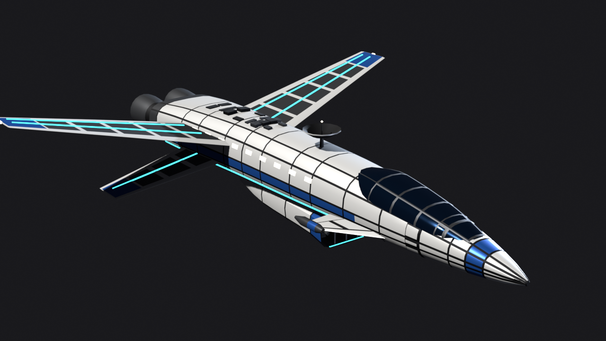
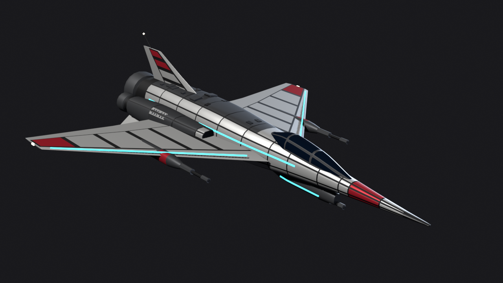
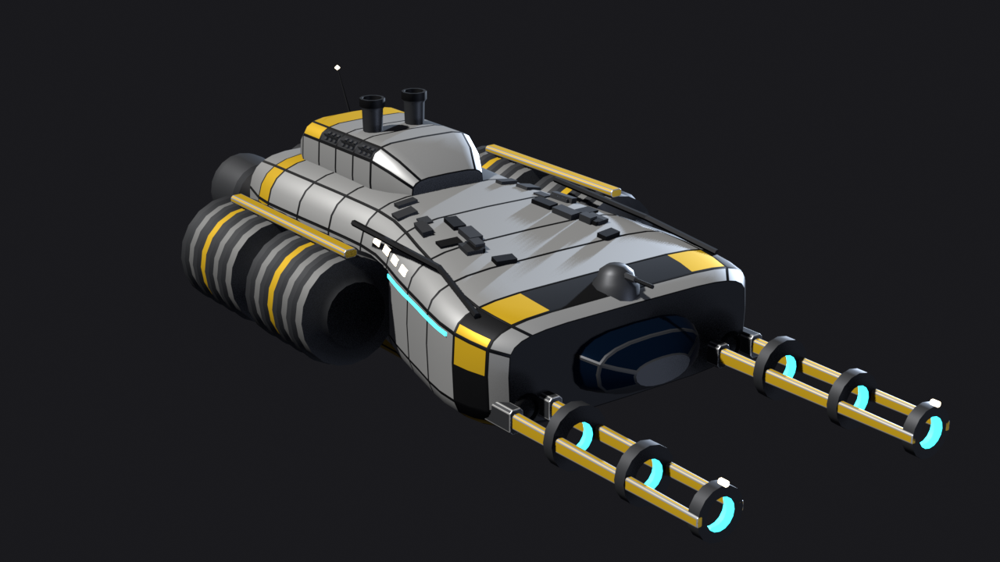
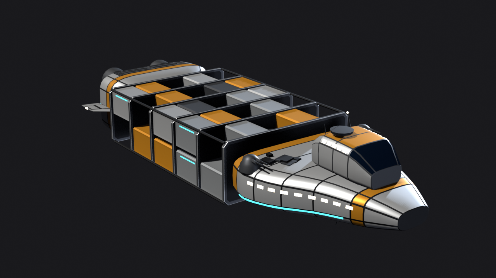
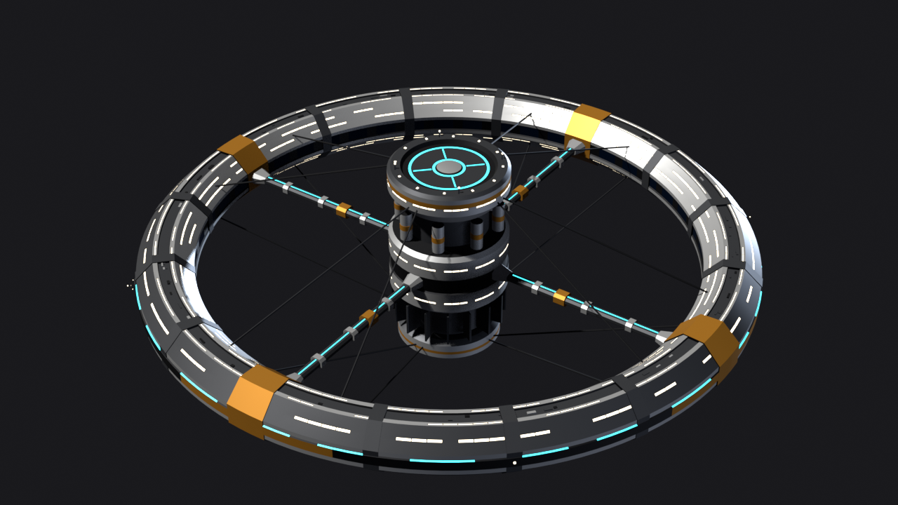
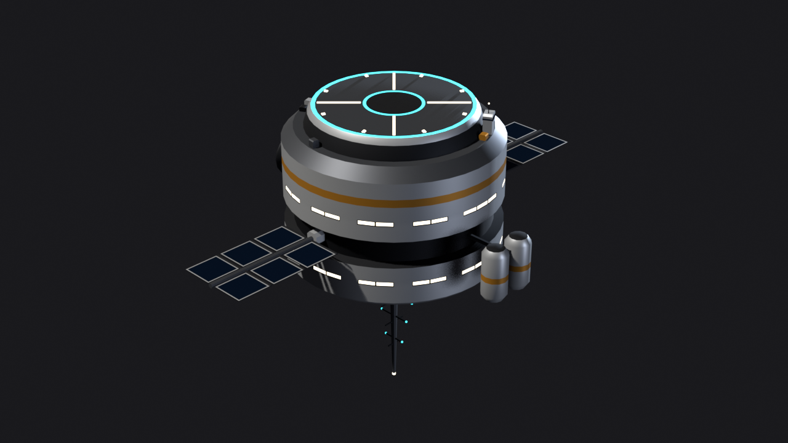
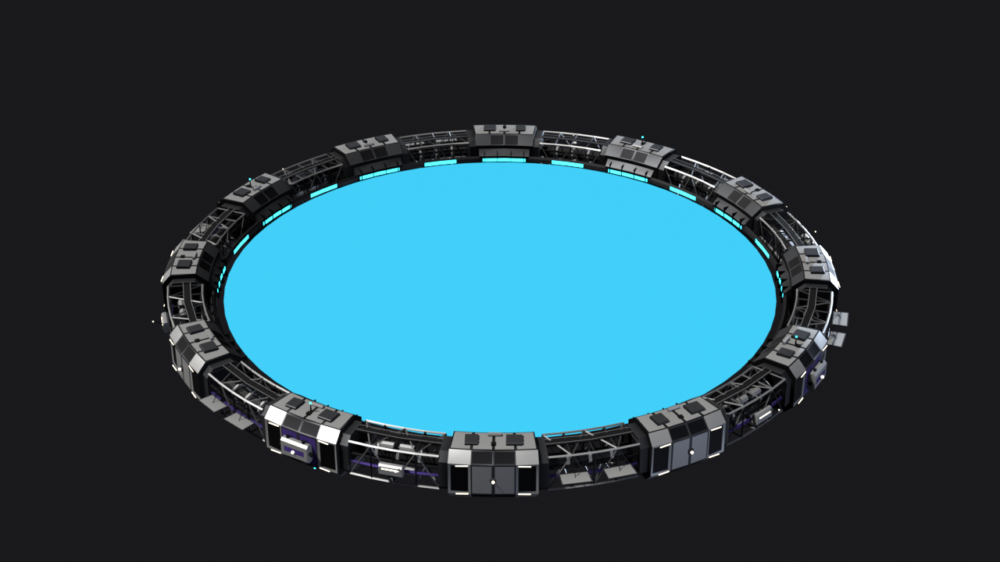
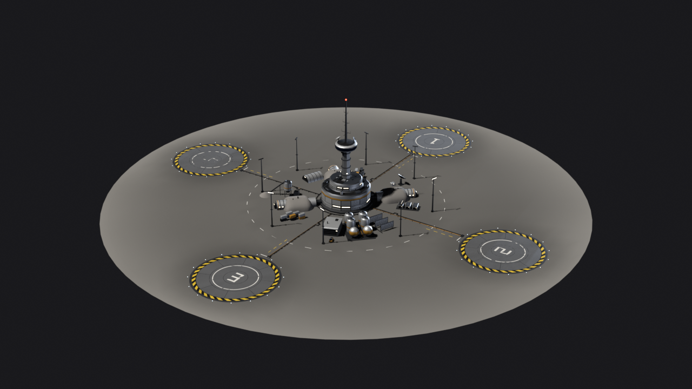

<div align="center">

# 🚀 PRIMACY2

**A space-sim MMORPG for the browser in which the players host the universe.**

[](#-project-status)
[](package.json)
[](LICENSE)

[](package.json)
[](https://www.typescriptlang.org/)
[](https://threejs.org/)
[](https://preactjs.com/)
[](https://vite.dev/)
[](https://vitest.dev/)
[](https://playwright.dev/)

🌌 No central server &nbsp;·&nbsp; 🔑 No accounts &nbsp;·&nbsp; 🧩 Nothing to install &nbsp;·&nbsp; 🆓 Free software

🇩🇪 [Deutsche Kurzanleitung](#-deutsch-kurzanleitung)

</div>

> [!WARNING]
> **🚧 PRIMACY2 is in early development.** It is version 0.1.0 and there is no release yet. The game
> is playable in the browser, but much of what is planned is not built, some of what is built has
> so far only been played by automated tests, and things still change. The table under
> [Project status](#-project-status) says what works today.

## ✨ What it is

Every server adds a *sector* of star systems to a shared galaxy. Servers link up with each other,
their sectors appear on each other's maps, and pilots fly from one to the next with their ship.
There is no central server, no account system and nothing to install to play.

<p align="center">
  
  
  
  
</p>
<p align="center">
  
  
  
  
</p>
<p align="center"><sub>Model previews rendered by the Blender scripts in <code>assets/blender</code>. They are not screenshots of the game.</sub></p>

## 🚧 Project status

Early development, playable in the browser. [docs/ROADMAP.md](docs/ROADMAP.md) has the full state,
the decisions and the order of the work.

| | Area | State |
|---|---|---|
| ✅ | Logging in, docking and undocking, flight, power distribution and silent running, two pilots meeting, combat, ship loss and insurance, flying to a wreck, cruise, the maps | Played through in the browser by the automated test (`scripts/e2e.mjs`) |
| ✅ | Trade between two servers: buying cargo, a fold jump with the handoff of the pilot to a second server, docking there, selling the cargo as an import with the tariff withheld, the flight home | Played through in the browser by the automated test |
| ✅ | Landing on airless moons: cruise down, descend, touch down, lift off, dock at a ground base | Played by the test on one rocky moon in daylight. Nobody has judged it in motion, at night, or on ice and desert bodies, and the ground close to the ship still looks soft |
| 🎮 | Controller support for flight, menus, station screens, maps and a binding screen | Played in the browser with a simulated controller (`scripts/pad-check.mjs`). No real controller has been used yet |
| 🧪 | Mining, salvaging a wreck, missions, NPC behaviour, warp gates | Implemented and covered by server tests, not yet played through in the browser |
| 🔊 | Sound | A sound library is being built and rated beside the game (`tools/audio`, `tools/sound`). The game itself still plays its old procedural sound |
| 📋 | Docking on scarce landing pads with clearance, customs and police, deeper mining, missions, exploration, economy, factions, onboarding | Decided, not built yet |

## 🕹️ Play

Open the address of any PRIMACY2 server in a current desktop browser. Your pilot is a key pair
that the game creates in your browser on first start; back it up from the start screen, because
whoever has the key is the pilot.

| Action | Default |
|---|---|
| Thrust forward, back, left, right | W S A D |
| Thrust up, down | Space, Ctrl (or C) |
| Roll | Q E |
| Turn | Mouse |
| Boost | Shift |
| Throttle setpoint | Mouse wheel |
| Fire primary, secondary | Left, right mouse button |
| Flight assist on/off | Z |
| Cruise (in-system faster-than-light) | J |
| Fold jump to the selected system | H |
| Dock / undock | F |
| Power to shields, engines, weapons | Arrow left, up, right |
| Reset power distribution | Arrow down |
| Silent running | B |
| Mining laser (also cuts wrecks) | R or middle mouse button |
| Galaxy map, system map | M, N |

All bindings can be changed in the settings. Browsers reserve Ctrl+W, so play in fullscreen or use C
for downward thrust.

## 🛰️ Host a sector

```sh
git clone https://github.com/nullthrone/primacy2.git
cd primacy2
npm install
npm start
```

You need Node.js 22.13 or newer. The server listens on port 8420 and serves the game itself.
To join the galaxy, name another server in `primacy2.config.json`:

```json
{ "name": "Kepler Verge", "publicUrl": "https://sector.example.org", "peers": ["https://another-sector.example.net"] }
```

Your sector is placed next to the first server it links with, close enough for a starter ship to
jump across. [docs/HOSTING.md](docs/HOSTING.md) covers configuration, reachability, trust and backups.

## 🔭 How it works

- **Flight:** star systems are true scale and bodies move on Kepler orbits. In normal flight ships
  obey Newtonian mechanics with real gravity; flight assist is a controller on top that makes them
  handle like a first-person shooter, and it can be switched off. Cruise crosses a system faster
  than light; fold jumps cross between systems.
- **Phenomena:** stars of every spectral class, black holes with gravitational time dilation and
  tidal forces, neutron stars, asteroid belts, ringed giants, fuel scooping in a star's corona.
- **Federation:** servers and pilots are identified by Ed25519 keys. Servers exchange signed
  descriptions of their sectors; a pilot moves between servers with a signed, single-use transfer
  ticket. A receiving server rebuilds every ship from ids with its own rules, so a dishonest server
  cannot hand out impossible ships.
- **Economy:** credits are local to each server. Value moves between servers as cargo in a hold, and
  each operator rates every neighbour as union, partner, visitor or blocked. A server trusts only its
  own books: goods from a partner sell within a trade balance and a per-pilot licence that starts
  small and grows with missions, bounties, survey data and mining, goods from a visitor are sealed, and
  ships from outside a customs union refund nothing. See `docs/ARCHITECTURE.md`.
- **Warp gates** bridge sectors that are too far apart to jump between. Both servers have to fund
  their half of the pair.

More detail: [docs/ARCHITECTURE.md](docs/ARCHITECTURE.md), [docs/CLIENT.md](docs/CLIENT.md),
[docs/MODULES.md](docs/MODULES.md).

## 🛠️ Develop

```sh
npm install
npm run dev          # two linked servers on :8420 and :8421
npm run dev:client   # client with hot reload on :5173, talking to :8420
npm test             # unit and integration tests
npm run typecheck
```

The development page is at `/dev/local.html` on the client server (`npm run dev:client`). The
browser test runs with `npm run build && node scripts/e2e.mjs`.

| Path | Contents |
|---|---|
| `packages/shared` | Types, protocol, flight model, universe generation, signatures. Runs in browser and Node. |
| `packages/server` | Authoritative simulation, persistence, federation, gameplay modules. |
| `packages/client` | Renderer (three.js), input, prediction, interface. |
| `assets/blender` | Python scripts that generate every 3D model in Blender. |
| `tests` | Integration tests that run real servers against a protocol-level client. |

## 📜 Licence

PRIMACY2 is free software under the [GNU Affero General Public License](LICENSE), version 3 or
later.

## 🇩🇪 Deutsch: Kurzanleitung

> **🚧 Früher Entwicklungsstand.** Das Spiel ist im Browser spielbar, aber vieles ist noch nicht
> gebaut, manches wurde bisher nur von automatischen Tests gespielt, und es ändert sich noch viel.
> Was heute geht, steht oben unter [Project status](#-project-status).

PRIMACY2 ist ein Weltraum-MMO im Browser, bei dem die Spieler das Universum selbst hosten: Jeder
Server bringt einen Sektor mit Sternsystemen mit, verbundene Server sehen einander auf der
Galaxiekarte, und Piloten reisen mit ihrem Schiff von Server zu Server.

- **Spielen:** Adresse eines Servers im Browser öffnen. Der Pilot ist ein Schlüsselpaar im Browser;
  sichere es über den Startbildschirm.
- **Selbst hosten:** `npm install`, dann `npm start` (Node.js ab 22.13). Der Server läuft auf Port 8420.
  Trage in `primacy2.config.json` unter `peers` einen anderen Server ein, um dich mit der Galaxie zu
  verbinden. Einzelheiten stehen in [docs/HOSTING.md](docs/HOSTING.md) (englisch).
- **Steuerung:** WASD für Schub, Q/E rollen, Leertaste hoch, Strg oder C runter, Maus zum Drehen,
  Umschalt für Boost. Die Oberfläche lässt sich auf Deutsch umstellen.
